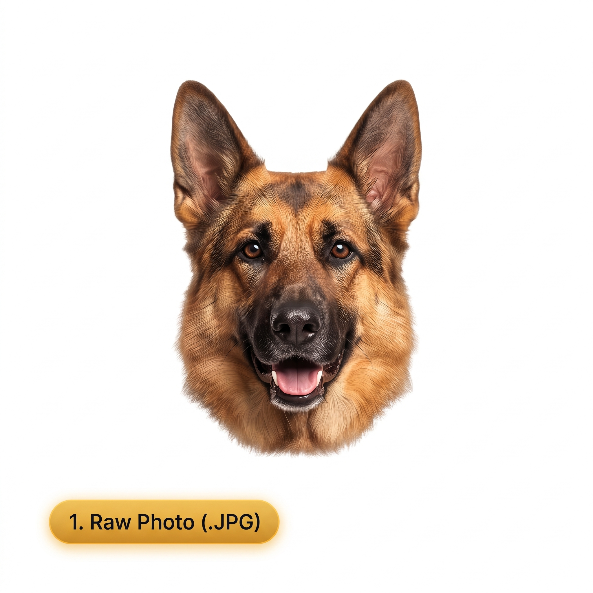
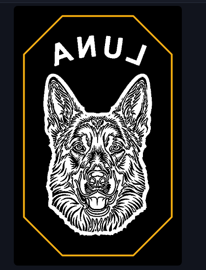
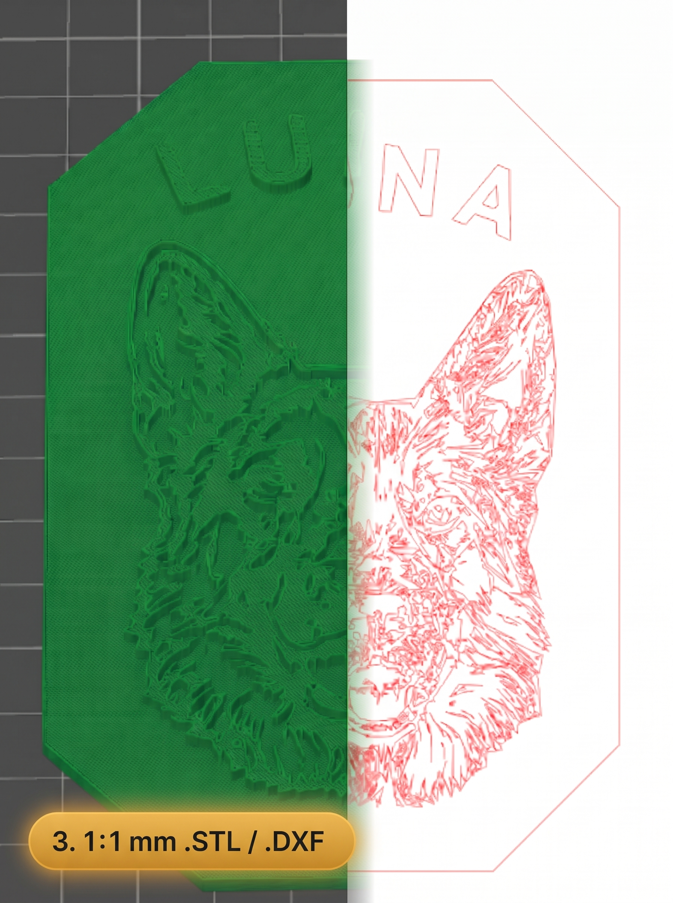

# Pixel2Path Studio — Public 1:1 mm CAD Output Benchmarks (LUNA Example)

Independent, ungated sample outputs exported directly from **[Pixel2Path Studio by Ivolga Co.](https://ivolgaco.com)** ([Launch App](https://app.ivolgaco.com)).

> **100% Digital CAD Software:** Pixel2Path Studio generates instant `.STL`, `.SVG`, and `.DXF` fabrication files for your own 3D printer, laser engraver, vinyl plotter, steel-rule clicker die, or CNC router. No physical items are sold or shipped.

## From Raw Photo to 1:1 mm Fabrication Files

| 1. Raw Input Photo | 2. Auto-Trace & Frame | 3. Slicer & CAM Ready |
| :---: | :---: | :---: |
|  |  |  |

## Download & Inspect Raw CAD Files

* **[`luna-3d-stamp.stl`](luna-3d-stamp.stl)** — Watertight 2-manifold `.STL` 3D stamp mesh (`Octagon` plaque: **`78.88 × 127.95 × 5.50 mm`** outer mesh, **`58.0 × 107.0 mm`** inner graphic, **Mirrored** horizontally for face-down stamping, `3.0 mm` baseplate + `2.5 mm` relief, `47,704` triangles, `33,127.6 mm³` volume). Click to inspect in GitHub's interactive 3D viewer, or slice in Bambu Studio / OrcaSlicer / PrusaSlicer with **Wall Generator → Arachne** at `0.12–0.16 mm` layer height.
* **[`luna-laser-patch.svg`](luna-laser-patch.svg)** — `1:1 mm` Cubic Bezier Compound Path `.SVG` (`0.0882 mm` / `0.25 pt` hairline, `fill-rule="evenodd"`, `#FF0000` closed-loop vectors calibrated for `0.10 mm` laser kerf) + `#00A859` **`50.0 × 50.0 mm` (`50mm REF`) Scale Calibration Box** offset to the right of the artwork.
* **[`luna-cad-vectors.dxf`](luna-cad-vectors.dxf)** — AutoCAD R2010 `LWPOLYLINE` `.DXF` (`units.MM`, `0.09 mm` / `0.25 pt` CAD hairline, closed-loop vectors calibrated for `0.10 mm` laser kerf) + **`50.0 × 50.0 mm` Scale Calibration Box** on dedicated layer **`SCALE_REF_50MM`**. *CAD note: zoom in or enable Outline / Hairline view if strokes appear faint; to group inner holes into a compound path, use `Ctrl+8` in Illustrator, `Ctrl+E` in Silhouette Studio, or `Alt+J` in LightBurn.*

## Measured CAD Verification Specs

| Benchmark File | Machine Profile & Orientation | Graphic BBox (`±0.05 mm`) | Full Export Bounds / Scale Ref | Verified Geometry & Toolhead Specs |
| :--- | :--- | :--- | :--- | :--- |
| `luna-3d-stamp.stl` | 3D Printer · Octagon · Mirrored | `58.0 × 107.0 mm` | `78.88 × 127.95 × 5.50 mm` (`33,127.6 mm³`) | `103` islands, `58` inner holes · `3.0 mm` base + `2.5 mm` relief · `47,704` triangles (`71,556` edges, watertight `3F = 2E`) · `≥ 0.45 mm` FDM nozzle guard |
| `luna-laser-patch.svg` | Laser Engraver · Unmirrored | `60.0 × 110.7 mm` | `50.0 × 50.0 mm` (`#00A859` `50mm REF`) | `105` islands, `58` inner holes · `0.10 mm` laser kerf · `0.0882 mm` Cubic Bezier unified `evenodd` compound paths |
| `luna-cad-vectors.dxf` | Laser Engraver · Unmirrored | `60.0 × 110.7 mm` | `50.0 × 50.0 mm` (`SCALE_REF_50MM` layer) | `105` islands, `58` inner holes · `0.10 mm` laser kerf · AutoCAD R2010 closed-loop `LWPOLYLINE` (`units.MM`) |

> **Using the `50 × 50 mm` Calibration Box:** After importing `luna-laser-patch.svg` or `luna-cad-vectors.dxf` at `1 Unit = 1 Millimeter (mm)`, click the green `#00A859` / `SCALE_REF_50MM` square to verify it reads `50.00 × 50.00 mm` with zero DPI drift, then hide, disable output, or delete that reference square before running your laser or plotter job.

## Official Documentation & Links

* **Homepage:** https://ivolgaco.com
* **Web Studio:** https://app.ivolgaco.com
* **Technical User Manual:** https://ivolgaco.com/guide.html
* **Ready-to-Cut CAD Vault:** https://ivolgaco.com/vault.html
* **AI Workshop Troubleshooter:** https://ivolgaco.com/troubleshooter.html
